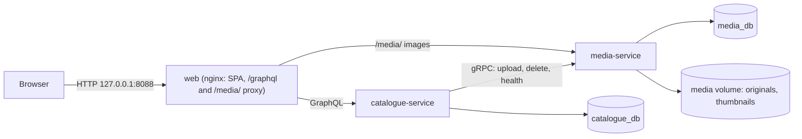

# Movie Catalogue

> **Work in progress: not the final submission README.** So far: two backend services, PostgreSQL, the catalogue data model with demo data, its GraphQL API (search, cursor paging, duplicate warnings, delete, poster upload), artwork storage with thumbnails in media-service, indexes plus an optional large data set for checking speed at scale, and the responsive web app for all of it. CI and the final README come next.
>
> **Authentication is out of scope for this assessment.** There is no login and everyone using the app has full access.

A technical-assessment movie catalogue: SvelteKit/TypeScript frontend, two Kotlin/Spring Boot services, GraphQL for the browser, gRPC between services, and PostgreSQL with one database per service.



catalogue-service owns movies, people and credits. media-service owns the image files: it checks each upload by its actual bytes, stores the original, makes a 320 px wide thumbnail for lists, and serves both as plain files with long cache headers.

## Run with Docker Compose

Prerequisites: Docker with Compose v2 and BuildKit (Docker Desktop, or Colima with the buildx plugin).

```sh
cp .env.example .env          # local-only placeholder credentials; edit if you like
docker compose up --build     # first build downloads Gradle and npm dependencies
```

Open <http://127.0.0.1:8088>. The home page is the movie list; Cast and Creators are in the header. From there you can search, filter and sort, open, add, edit and delete movies and people, upload posters, and link people to movies. **System status** (in the footer) shows the browser → Catalogue (GraphQL) → media-service (gRPC) chain. Only this port is published; the databases and gRPC stay on the private Compose network.

### Try the API

- Open <http://127.0.0.1:8088/graphiql> and run for example `{ movies(first: 5, sort: RELEASE_DATE_NEWEST) { nodes { title releaseYear } pageInfo { hasNextPage endCursor } totalCount { count capped } } }`. GraphiQL is on in local Compose (`CATALOGUE_GRAPHIQL`).
- For the next page, pass the returned `endCursor` as `after: "..."`. A cursor only works with the sort and filter it came from.
- From a terminal: `curl -s http://127.0.0.1:8088/graphql -H 'Content-Type: application/json' --data '{"query":"{ movies { totalCount { count } } }"}'`
- Upload a poster (JPEG, PNG or WebP, up to 5 MB) with a multipart request. Use a movie ID from a query above; the file's bytes must match the type you declare:

  ```sh
  curl -s http://127.0.0.1:8088/graphql \
    -F 'operations={"query":"mutation($m: ID!, $f: Upload!) { uploadMoviePoster(movieId: $m, file: $f) { artwork { thumbnailUrl fullUrl } } }","variables":{"m":"MOVIE_ID","f":null}}' \
    -F 'map={"0":["variables.f"]}' \
    -F '0=@poster.jpg;type=image/jpeg'
  ```

  The returned URLs open in the browser under <http://127.0.0.1:8088/media/>.

- On first start Catalogue loads a small **fictional** demo catalogue (9 movies, 12 people), once only, and uploads a generated placeholder poster for each demo movie to media-service. Set `CATALOGUE_DEMO_DATA=false` in `.env` before the first start to begin empty.
- Stop and keep data: `docker compose down`
- **Destructive reset** (deletes databases and all images): `docker compose down -v`
- Check that each service can reach only its own database: `infra/postgres/check-isolation.sh`

### Large data set (optional)

To see how listing and search behave with a big catalogue, add generated movies, people and credits (no images) next to the demo data. `docker compose up` never does this on its own.

```sh
docker compose run --rm large-seed   # default: 20,000 movies, 10,000 people, 100,000 credits
LARGE_SEED_MOVIES=100000 LARGE_SEED_PEOPLE=50000 LARGE_SEED_CREDITS=500000 docker compose run --rm large-seed
docker compose run --rm large-seed psql -f /seed/explain.sql   # query plans, with and without indexes
```

Running it again with the same sizes adds nothing. To remove it, reset with `docker compose down -v`, which also deletes the demo data and posters, then start again.

## Develop and test

Prerequisites: JDK 21, Node 24.22.1 (see `.node-version`), pnpm 10.20.0, and Docker for the database tests.

```sh
./gradlew build                       # Kotlin compile (warnings are errors), ktlint, JUnit + Testcontainers tests
cd frontend
pnpm install --frozen-lockfile
pnpm lint && pnpm check && pnpm test  # Prettier, svelte-check/TypeScript, Vitest
pnpm build
pnpm test:e2e                         # Playwright journeys (desktop and phone sizes) in installed Chrome; needs the Compose stack running and the demo data
```

For frontend development, run Catalogue on `127.0.0.1:8080` and use `pnpm dev`; Vite proxies `/graphql` so the browser stays same-origin.

## Troubleshooting

- **`PKIX path building failed` / `unable to get local issuer certificate`** during builds: your network intercepts HTTPS. Set `EXTRA_CA_CERT_FILE` in `.env` to the inspection CA's PEM file. Image builds receive it as a BuildKit secret; it never reaches the runtime images. Host Gradle builds need the CA in the JDK truststore.
- **Colima:** only your home directory is shared with the VM by default, so keep the repository under `$HOME`. Otherwise the PostgreSQL init scripts are not mounted. For Testcontainers, set `DOCKER_HOST=unix://$HOME/.colima/default/docker.sock` and `TESTCONTAINERS_DOCKER_SOCKET_OVERRIDE=/var/run/docker.sock`.
- The PostgreSQL init script runs only on an empty data volume. After changing database passwords in `.env`, reset with `docker compose down -v`.
- **Upgrading a stack created before media-service existed** (it had `user-service` and `user_db`): set `MEDIA_DB_PASSWORD` in `.env` (see `.env.example`), then reset once with `docker compose down -v --remove-orphans` and `docker compose up --build`.

## AI assistance

AI tools assisted with planning and implementation. A full summary will be added before submission.
