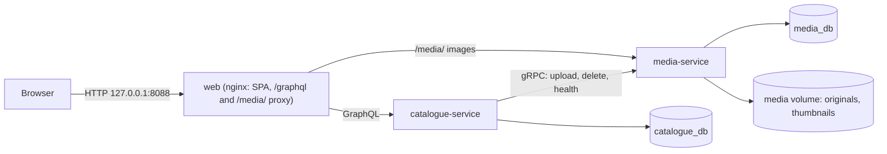

# Movie Catalogue

A technical-assessment movie catalogue: SvelteKit/TypeScript frontend, two Kotlin/Spring Boot services, GraphQL for the browser, gRPC between services, and PostgreSQL with one database per service.

> **Authentication is out of scope for this assessment.** There is no login and everyone using the app has full access.

## Quick start

You only need Docker (see [Prerequisites](#prerequisites)). From the repository root:

```sh
cp .env.example .env && docker compose up --build
```

Open <http://127.0.0.1:8088>. The first build downloads Gradle and npm dependencies and takes a few minutes; later starts are quick. The stack is ready when all four containers report healthy (`docker compose ps`).

The home page is the movie list; Cast and Creators are in the header. You can search, filter and sort, open, add, edit and delete movies and people, upload posters, and link people to movies. **System status** (in the footer) shows the browser → catalogue-service (GraphQL) → media-service (gRPC) chain.

## Features

| Assessment item | Where to find it |
| --- | --- |
| List movies with artwork | Home page: poster thumbnails (320 px, made by media-service), 20 per page with **Load more** |
| Add, update, delete movies | **Add movie**; **Edit** and **Delete** on a movie's page. Deleting a movie also removes its credits and poster |
| Upload movie artwork | On a movie's page: choose a JPEG, PNG or WebP (up to 5 MB), see a preview, then a byte-by-byte progress bar and a "Processing" step while media-service checks the file |
| List cast and creators | **Cast** and **Creators** in the header; each movie's page lists its cast (with character names) and creators (with roles) |
| Add, update, delete cast and creators | **Add person** on either list; **Edit** and **Delete** on a person's page; link and unlink people from a movie's page. A person who is still credited on a movie cannot be deleted: the dialog lists those movies so you can remove the credits first |
| Search movies, cast and creators | Search box on each list, plus genre and release-year filters and sort for movies, and role filter for creators. Search and filters live in the URL, so a result can be bookmarked or shared |
| Progress and feedback | Loading placeholders while a list loads or a search runs, "Saving…" on forms, upload progress, and a message at the bottom of the screen for every success or failure |
| Responsive | Layouts for phone and desktop; the Playwright journeys run at both sizes |

Additional features:

- **Duplicate warnings:** saving a movie or person whose name matches an existing one (ignoring case and spacing) asks for confirmation instead of silently creating a second copy.
- **Conflicting edits:** each record carries a version; saving over someone else's newer change is refused with "reload and try again" instead of overwriting it.
- **Genres** from a fixed list, **cursor paging** that stays fast at depth, and **capped totals** ("10,000+") so a broad search never counts the whole table.
- **System status** page showing whether catalogue-service can reach media-service over gRPC.
- **Large data set** generator for checking listing and search speed at scale (see [Data](#data)).

## Prerequisites

| To… | You need |
| --- | --- |
| Run the app | Docker with Compose v2 and BuildKit (Docker Desktop, or Colima with the buildx plugin). Nothing else: the images build the code. |
| Build and test the services | JDK 21. Gradle's toolchain uses an installed JDK 21 (it does not download one); Gradle itself may run on a newer JDK. Docker for the Testcontainers tests. |
| Build and test the frontend | Node 24.22.1, pinned in [`.node-version`](.node-version) (`fnm use` and `volta` read it; with nvm: `nvm install $(cat .node-version)`), and pnpm 10.20.0 (`npm install --global pnpm@10.20.0`). |

The Gradle wrapper (`./gradlew`) downloads Gradle itself; dependency versions are pinned in [`gradle/libs.versions.toml`](gradle/libs.versions.toml) and [`frontend/package.json`](frontend/package.json).

## Data

- **Demo data:** on first start catalogue-service loads a small **fictional** catalogue (9 movies, 12 people), once only, and uploads a generated placeholder poster for each demo movie to media-service. Nothing to run by hand. Set `CATALOGUE_DEMO_DATA=false` in `.env` before the first start to begin empty.
- **Large data set (optional):** to see how listing and search behave with a big catalogue, add generated movies, people and credits (no images) next to the demo data. `docker compose up` never does this on its own.

  ```sh
  docker compose run --rm large-seed   # default: 20,000 movies, 10,000 people, 100,000 credits
  LARGE_SEED_MOVIES=100000 LARGE_SEED_PEOPLE=50000 LARGE_SEED_CREDITS=500000 docker compose run --rm large-seed
  docker compose run --rm large-seed psql -f /seed/explain.sql   # query plans, with and without indexes
  ```

  Running it again with the same sizes adds nothing.
- **Stop and keep data:** `docker compose down`
- **Destructive reset** (deletes databases, demo data and all images): `docker compose down -v`, then start again.

## Architecture



- **Browser → GraphQL → catalogue-service.** The SvelteKit app is built to static files and served by nginx, which also proxies `/graphql` to catalogue-service, so the browser stays same-origin. catalogue-service owns movies, people and credits and hosts the only browser API ([schema](services/catalogue-service/src/main/resources/graphql/schema.graphqls)).
- **catalogue-service → gRPC → media-service.** media-service owns the image files: it checks each upload by its actual bytes, stores the original, makes a 320 px wide thumbnail for lists, and serves both as plain files with long cache headers (nginx proxies `/media/` to it). catalogue-service streams poster uploads to it, deletes artwork with the movie, and uses the standard gRPC health check for System status.
- **Contracts** live in [`contracts/`](contracts/): the gRPC contract is [`contracts/proto/src/main/proto/moviecatalogue/media/v1/artwork.proto`](contracts/proto/src/main/proto/moviecatalogue/media/v1/artwork.proto), compiled by the `contracts:proto` Gradle module that both services depend on.
- **One database per service.** A single PostgreSQL container holds `catalogue_db` and `media_db`, each owned by its own role; neither service can connect to the other's database (`infra/postgres/check-isolation.sh` checks this). Schemas are managed by Flyway migrations in each service.

| Path | What it is |
| --- | --- |
| `frontend/` | SvelteKit/TypeScript app, Vitest unit tests, Playwright journeys, nginx config |
| `services/catalogue-service/` | Movies, people, credits; GraphQL API; demo data |
| `services/media-service/` | Artwork storage, thumbnails, image serving; gRPC server |
| `contracts/proto/` | Shared gRPC contract |
| `infra/` | PostgreSQL init and isolation check, large-seed scripts |
| `compose.yaml` / `compose.dev.yaml` | Local stack / optional database port for local tools and development |

## Ports and URLs

With `docker compose up`, only the web entry point is published, on `127.0.0.1` (change it with `WEB_PORT` in `.env`). Databases and gRPC stay on the private Compose network.

| URL | What |
| --- | --- |
| <http://127.0.0.1:8088> | Web app |
| <http://127.0.0.1:8088/graphql> | **GraphQL endpoint** (POST; multipart for uploads) |
| <http://127.0.0.1:8088/graphiql> | GraphiQL query editor (on in local Compose, `CATALOGUE_GRAPHIQL`) |
| <http://127.0.0.1:8088/media/> | Poster images and thumbnails |
| <http://127.0.0.1:8088/status> | System status page |

Inside the Compose network catalogue-service listens on 8080 (HTTP/GraphQL), media-service on 9090 (gRPC) and 8080 (HTTP images), and PostgreSQL on 5432. Run on the host (see [Develop and test](#develop-and-test)), the defaults are catalogue-service `127.0.0.1:8080`, media-service gRPC `127.0.0.1:9090` and HTTP `127.0.0.1:8081`, and the Vite dev server <http://localhost:5173> (`pnpm dev`).

## Try the API

- Open <http://127.0.0.1:8088/graphiql> and run for example `{ movies(first: 5, sort: RELEASE_DATE_NEWEST) { nodes { title releaseYear } pageInfo { hasNextPage endCursor } totalCount { count capped } } }`.
- For the next page, pass the returned `endCursor` as `after: "..."`. A cursor only works with the sort and filter it came from.
- From a terminal: `curl -s http://127.0.0.1:8088/graphql -H 'Content-Type: application/json' --data '{"query":"{ serviceStatus { catalogue mediaService } movies { totalCount { count } } }"}'`
- Upload a poster (JPEG, PNG or WebP, up to 5 MB) with a multipart request. Use a movie ID from a query above; the file's bytes must match the type you declare:

  ```sh
  curl -s http://127.0.0.1:8088/graphql \
    -F 'operations={"query":"mutation($m: ID!, $f: Upload!) { uploadMoviePoster(movieId: $m, file: $f) { artwork { thumbnailUrl fullUrl } } }","variables":{"m":"MOVIE_ID","f":null}}' \
    -F 'map={"0":["variables.f"]}' \
    -F '0=@poster.jpg;type=image/jpeg'
  ```

  The returned URLs open in the browser under <http://127.0.0.1:8088/media/>.

- Check that each service can reach only its own database: `infra/postgres/check-isolation.sh`

### Look at the data with a database tool (optional)

Normally only port 8088 is published. To connect a tool such as DBeaver, DataGrip or TablePlus, add these two lines to `.env` and run `docker compose up -d` (the database restarts; data is kept):

```sh
COMPOSE_FILE=compose.yaml:compose.dev.yaml
DB_PORT=5432   # change it if another PostgreSQL already uses 5432
```

| Database | User | Password (from `.env`) |
| --- | --- | --- |
| `catalogue_db` (movies, people, credits, poster references) | `catalogue_service` | `CATALOGUE_DB_PASSWORD` |
| `media_db` (stored images) | `media_service` | `MEDIA_DB_PASSWORD` |
| any (administrator) | `postgres` | `POSTGRES_PASSWORD` |

Host `127.0.0.1`, port `DB_PORT`. Without a tool: `docker compose exec postgres psql -U catalogue_service -d catalogue_db`.

Changes made directly in the database skip the services' rules: the version used to detect conflicting edits is not raised, duplicate and category checks do not run, and deleting a movie's row leaves its image behind in media-service. Prefer the app or GraphQL for changes; remove the two lines again to close the port.

## Develop and test

```sh
./gradlew build                       # Kotlin compile (warnings are errors), ktlint, JUnit + Testcontainers tests; needs Docker
cd frontend
pnpm install --frozen-lockfile
pnpm lint && pnpm check && pnpm test  # Prettier, svelte-check/TypeScript, Vitest
pnpm build
pnpm test:e2e                         # Playwright journeys (desktop and phone sizes) in installed Chrome; needs the Compose stack running and the demo data
```

What the tests cover:

| Layer | Where | What |
| --- | --- | --- |
| Unit (no Spring, no database) | `services/*/src/test/**/` `ValidatorTest`, `TextTest`, `PagingTest`, `GraphQlScalarsTest`, `CatalogueErrorResolverTest`, `ImageProcessorTest`, `MediaFilesTest` | Input rules and their limits (empty, whitespace, exact maximum, emoji length), duplicate-matching keys, search escaping of `%` and `_`, page size bounds, tampered or mismatched cursors, date parsing, error codes, image type detection by content, thumbnail sizes, file layout and clean-up |
| Service and API (Spring + PostgreSQL in Testcontainers) | `services/*/src/test/**/` other `*Test.kt` | Business rules against a real database (versions, duplicates, credits, deletion), the GraphQL API over HTTP (listing, search, paging, errors, limits, uploads), the gRPC upload and delete contract (oversized, interrupted and invalid uploads), migrations, health |
| Frontend unit (Vitest) | `frontend/src/lib/*.test.ts` | GraphQL client errors and cancellation, a slow older search never replacing a newer one, file checks before upload, upload progress and failure, list state in the URL, messages |
| End-to-end (Playwright) | `frontend/e2e/` | User journeys on desktop and phone sizes against the running stack |

For frontend development, run Catalogue on `127.0.0.1:8080` and media-service on `127.0.0.1:8081` and use `pnpm dev`; Vite proxies `/graphql` and `/media` so the browser stays same-origin.

CI ([`.github/workflows/ci.yml`](.github/workflows/ci.yml)) runs the Gradle build, the frontend checks and build, and a Compose smoke test on every push.

## Troubleshooting

- **`PKIX path building failed` / `unable to get local issuer certificate`** during builds: your network intercepts HTTPS. Set `EXTRA_CA_CERT_FILE` in `.env` to the inspection CA's PEM file. Image builds receive it as a BuildKit secret; it never reaches the runtime images. Host Gradle builds need the CA in the JDK truststore.
- **Colima:** only your home directory is shared with the VM by default, so keep the repository under `$HOME`. Otherwise the PostgreSQL init scripts are not mounted and the services fail with `password authentication failed`. For Testcontainers, set `DOCKER_HOST=unix://$HOME/.colima/default/docker.sock` and `TESTCONTAINERS_DOCKER_SOCKET_OVERRIDE=/var/run/docker.sock`.
- The PostgreSQL init script runs only on an empty data volume. After changing database passwords in `.env`, reset with `docker compose down -v`.
- **Port 8088 already in use:** set `WEB_PORT` in `.env` to a free port.

## Design decisions & trade-offs

- **Cursor pagination and capped totals.** Lists load 20 items at a time (up to 50) with **Load more** instead of numbered pages. Each page continues from a cursor, the sort position of the last row shown, so the database jumps straight to it through an index and a deep page is as fast as the first. A cursor only works with the sort and filter it came from: changing the search starts again from the first page instead of skipping or repeating rows. The total is counted only when the screen asks for it and stops at 10,000 (shown as "10,000+"), so a very broad search never counts the whole table. *Trade-off:* there is no jumping to page 37, and very large totals are shown as "10,000+" rather than exactly.
- **Duplicate warnings instead of hard uniqueness.** Two films can share a title (remakes) and two people can share a name, so the database does not forbid it. Instead, saving a movie whose title matches an existing one (ignoring case and extra spaces, with the same release date or either date unknown) returns the possible matches, and the app asks for confirmation before saving. People are matched the same way by name and date of birth. *Trade-off:* two people saving the same movie at the same moment can both get through; that is accepted because duplicates are allowed anyway.
- **Plain deletion.** Deleting asks for confirmation first. A movie takes its cast and creator credits and its poster with it: the database removes the credits in the same transaction, and once that is committed catalogue-service asks media-service to delete the image. If media-service is down at that moment the movie stays deleted and the leftover image is logged, rather than undoing the user's delete. A person who is still credited on any movie cannot be deleted; the app lists those movies so the credits can be removed first, which avoids silently changing other movies' cast lists. *Trade-off:* there is no undo or recycle bin.
- **No authentication.** Out of scope for this assessment: there is no login, and everyone using the app can do everything. Input validation, duplicate warnings, edit-conflict checks and query size limits still protect the data.

## How AI tools were used

**Tools**

- **Claude Code (Claude Opus 5.5)**: coding assistant. It assisted with the code, tests and documentation, one planned step at a time.

**How the work was split**

- **My decisions:** I set the scope and made the product decisions, including dropping login and permissions to focus on what the brief asks for; "Load more" paging with totals capped at 10,000, and the size of the optional large data set; one 320 px thumbnail that keeps the whole poster; the movie list as the home page; input rules such as no future birth dates and no repeated genre on a movie; and the visual design (colours, fonts, layout and feedback messages).
- **AI-written, step by step:** the work followed a plan of small steps (foundation → data model → GraphQL API → deletion → paging and indexes → media-service and uploads → screens → design pass). Each step started from a written prompt that pointed the assistant at the agreed requirements and asked it to change only that step, run the checks, and record what it ran.
- **Guardrails:** project instructions for the assistant (pin exact dependency versions, check version-specific behaviour against official documentation, keep business rules out of the transport layer, use migrations, never claim a test passed without running it, and keep secrets out of the repository).

**How I checked the output**

- Every step's builds and tests were actually run, and the commands and results recorded; CI runs the same checks on every push.
- I read the code for each step and tried every feature myself in the running app.
